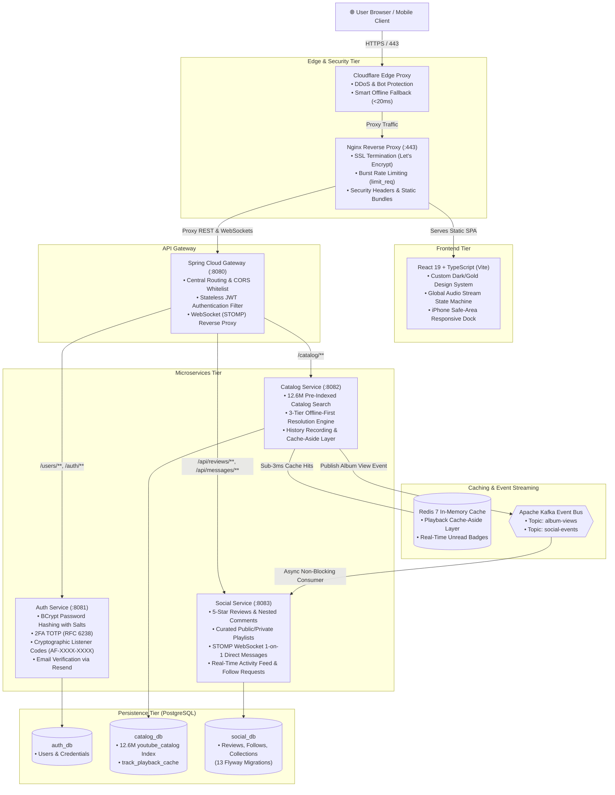

# Aficio — Music Social & Discovery Platform

<a href="https://aficio.shivesh29.me" target="_blank" rel="noopener noreferrer"></a>
[](https://openjdk.org/)
[](https://spring.io/projects/spring-boot)
[](https://react.dev/)
[](https://www.typescriptlang.org/)
[](https://www.postgresql.org/)
[](https://redis.io/)
[](https://kafka.apache.org/)
[](https://www.docker.com/)
[](https://www.cloudflare.com/)
[](https://azure.microsoft.com/)

**Aficio** is a distributed, full-stack music discovery, review, and social streaming platform. Built on a resilient **microservices architecture** with **Spring Boot 3**, **Spring Cloud Gateway**, **Apache Kafka**, **Redis**, and a modern **React 19 + TypeScript** frontend, Aficio enables music enthusiasts to catalog albums, write rich reviews, stream audio, curate custom lists, and connect with friends via private Listener Codes.

Live Production URL: <a href="https://aficio.shivesh29.me" target="_blank" rel="noopener noreferrer"><strong>https://aficio.shivesh29.me</strong></a>

---

## 🏛️ System Architecture



---

## ✨ Key Features

* **Zero-Quota Offline-First Audio Streaming:**
  * Powered by a pre-indexed **12.6-million-track database** (LAION-DISCO dataset).
  * 3-tier local resolution engine: **Redis Cache hit ($<3\text{ms}$)** $\rightarrow$ **12.6M Catalog Query ($<8\text{ms}$)** $\rightarrow$ **Cross-Album Studio Fallback**. Zero external third-party API dependencies or quota limits.
* **Music Graph & Catalog Exploration:** Integrated discographies, release groups, and high-resolution album art with phonetic transliteration matching.
* **Privacy by Default & Listener Codes (`AF-XXXX-XXXX`):**
  * Accounts are private by default and completely unlisted from public search to prevent enumeration scraping.
  * Users connect and share profiles exclusively via cryptographic, random 10-character Listener Codes.
* **Two-Factor Authentication (2FA / TOTP):** Optional RFC 6238 time-based authenticator app integration with QR code provisioning.
* **Ratings & Rich Reviews:** 5-star scoring system with markdown critiques, community likes, and nested discussions.
* **Curated Music Lists:** Custom tracklists and album dossiers with public vs. private visibility toggles.
* **Real-Time Direct Messaging (STOMP WebSockets):** Low-latency 1-on-1 messaging featuring read receipts, dynamic unread badges, and UTC timezone normalization.
* **Smart Edge Fallback & Sustainable Cloud Scheduling:**
  * Automated cloud operating schedule (**9:00 AM – 11:00 PM IST**), preserving cloud grant credits to achieve 5+ months of continuous runtime.
  * When the origin server powers down at night, a **Cloudflare Serverless Edge Worker** immediately intercepts connection timeouts and serves a styled off-hours status page with a real-time countdown timer to the next live session.

---

## 🛠️ Tech Stack & Engineering Highlights

| Layer | Technologies |
|:---|:---|
| **Frontend** | React 19, TypeScript, Vite, React Router 7, Lucide Icons, Custom CSS Design System |
| **Backend** | Java 21, Spring Boot 3.4.1, Spring Cloud Gateway, Spring Data JPA, Spring Security |
| **Event Bus & Messaging** | Apache Kafka 3 (Event-Driven Decoupling), STOMP over SockJS/WebSockets |
| **Databases & Cache** | PostgreSQL 16 (Multi-Schema Pattern: 12.6M+ indexed records), Redis 7 (Alpine), Flyway DB Migrations |
| **Security & Auth** | JWT (HMAC-SHA256), BCrypt Salting, RFC 6238 TOTP 2FA, Nginx Rate Limiting (`limit_req_zone`) |
| **DevOps & Cloud** | Docker Compose, Azure Linux VM (Central India), Cloudflare Edge Workers, Nginx, Let's Encrypt (Certbot), GitHub Actions |

---

## 💡 Engineering Deep Dives

### 1. Zero-Quota 12.6M Track Resolution Engine
Rather than relying on brittle third-party streaming APIs that enforce strict rate limits and break at scale, Aficio indexes **12,684,862 pre-crawled tracks** directly in PostgreSQL. Using B-Tree indexed foreign-key lookups combined with a Redis Cache-Aside layer, playback resolution takes **under 3 milliseconds** on cache hits and under 8 milliseconds on cold catalog queries.

### 2. Edge Fallback via Cloudflare Serverless Workers
To sustainably manage cloud resources on a student grant without sacrificing portfolio reliability, the Azure VM operates on a scheduled 14-hour daily window (9:00 AM to 11:00 PM IST). A Cloudflare Worker sits in front of the origin IP:
- **During active hours:** Proxies traffic seamlessly to the live application.
- **During nightly sleep:** Detects the offline server and immediately returns an optimized maintenance page with a live JavaScript countdown timer and recruiter dossier in under 20ms.

### 3. Asynchronous Event Decoupling with Apache Kafka
Social actions (such as album views, follower notifications, and review likes) are published as immutable domain events to Kafka topics (`album-views`, `social-events`). This prevents downstream database writes from blocking real-time audio streaming.

### 4. Defense-in-Depth Security
- **Anti-Scraping Privacy:** Usernames are unlisted; accounts are addressable only via random 10-character Listener Codes (`AF-XXXX-XXXX`).
- **Nginx Rate Limiting:** Sensitive endpoints (`/users/login`, `/users/register`) are throttled with a burst buffer of 10 requests, neutralizing brute-force and credential-stuffing attacks.
- **Network Isolation:** PostgreSQL and Redis containers do not expose public ports to the internet; they are accessible only via the internal Docker bridge network (`aficio-net`).
- **Automated Database Backup Rotation:** Nightly database dumps execute at 10:30 PM IST with automated 7-day archive pruning.

---

## 🛠️ Local Development & Orchestration

The local Docker Compose configuration boots the complete microservice mesh, Kafka event broker, Redis cache, and multi-schema PostgreSQL persistence tier in isolated bridge networking.

> [!NOTE]
> **Production vs. Local Catalog:** The complete **12.6M-track indexed catalog** and audio streaming engine are hosted on the live [Production Deployment](https://aficio.shivesh29.me). Fresh local environments boot with migrated schemas and can be optionally hydrated with synthetic community test data.

### Spin-up

```bash
# 1. Initialize environment variables with local defaults
cp .env.example .env

# 2. Build and boot all microservices, Kafka, Redis & PostgreSQL
docker compose up -d --build

# 3. (Optional) Hydrate with 15 synthetic music personas, reviews & listening history
./scripts/seed/apply_seed.sh
```

### Local Service Endpoints

| Service | Address | Description |
|:---|:---|:---|
| **Frontend Client** | [http://localhost:5174](http://localhost:5174) | React 19 SPA (Vite) |
| **Spring Cloud Gateway** | [http://localhost:8080](http://localhost:8080) | Single entry point & JWT filter |
| **Auth Service** | `http://localhost:8081` | BCrypt, TOTP 2FA, Listener Codes |
| **Catalog Service** | `http://localhost:8082` | Resolution engine & track index |
| **Social Service** | `http://localhost:8083` | Reviews, lists & STOMP WebSockets |
| **PostgreSQL 16** | `localhost:5432` | Multi-DB (`auth_db`, `catalog_db`, `social_db`) |
| **Redis 7** | `localhost:6379` | In-memory cache & Pub/Sub |
| **Apache Kafka** | `localhost:9092` | Event broker (`album-views`, `social-events`) |

To monitor logs or tear down the stack:
```bash
docker compose logs -f      # Follow unified cluster logs
docker compose down         # Gracefully terminate all containers
```

---

## 📂 Repository Structure

```text
aficio/
├── .github/workflows/          # GitHub Actions CI automation (Java & React test/build)
├── frontend/                   # React 19 + TypeScript + Vite Single Page Application
│   ├── src/
│   │   ├── api/                # Typed REST client and models
│   │   ├── components/         # Shared UI components (Navbar, Modals, MiniPlayer, AudioDock)
│   │   ├── context/            # AuthContext, PlayerContext global state providers
│   │   ├── pages/              # Catalog, AlbumDetail, Messages, Profile, Settings
│   │   └── utils/              # UTC-aware date utilities and formatters
├── services/
│   ├── api-gateway/            # Spring Cloud Gateway & JWT validation (Port 8080)
│   ├── auth-service/           # User auth, BCrypt, 2FA TOTP, Listener Codes, Resend (Port 8081)
│   ├── catalog-service/        # 12.6M catalog index, 3-tier playback resolution (Port 8082)
│   └── social-service/         # Reviews, lists, DMs, STOMP WebSockets, Kafka consumers (Port 8083)
├── shared/
│   ├── dto-lib/                # Shared Java records and DTO contracts
│   └── kafka-events/           # Shared event schemas and publishers
├── scripts/
│   ├── backup_databases.sh     # Automated nightly PostgreSQL backup and pruning script
│   ├── maintenance/            # Cloudflare Worker reverse proxy & offline fallback page
│   └── seed/                   # Realistic user, social, and catalog SQL generators
├── tests/load/                 # k6 load testing scripts (sustained 250+ concurrent VUs)
├── docker-compose.yml          # Production & local multi-container orchestration
└── init-dbs.sh                 # Database initialization script for multi-schema PostgreSQL
```

---

## 📄 License

Copyright &copy; 2026 Shivesh Sharma. All rights reserved.
