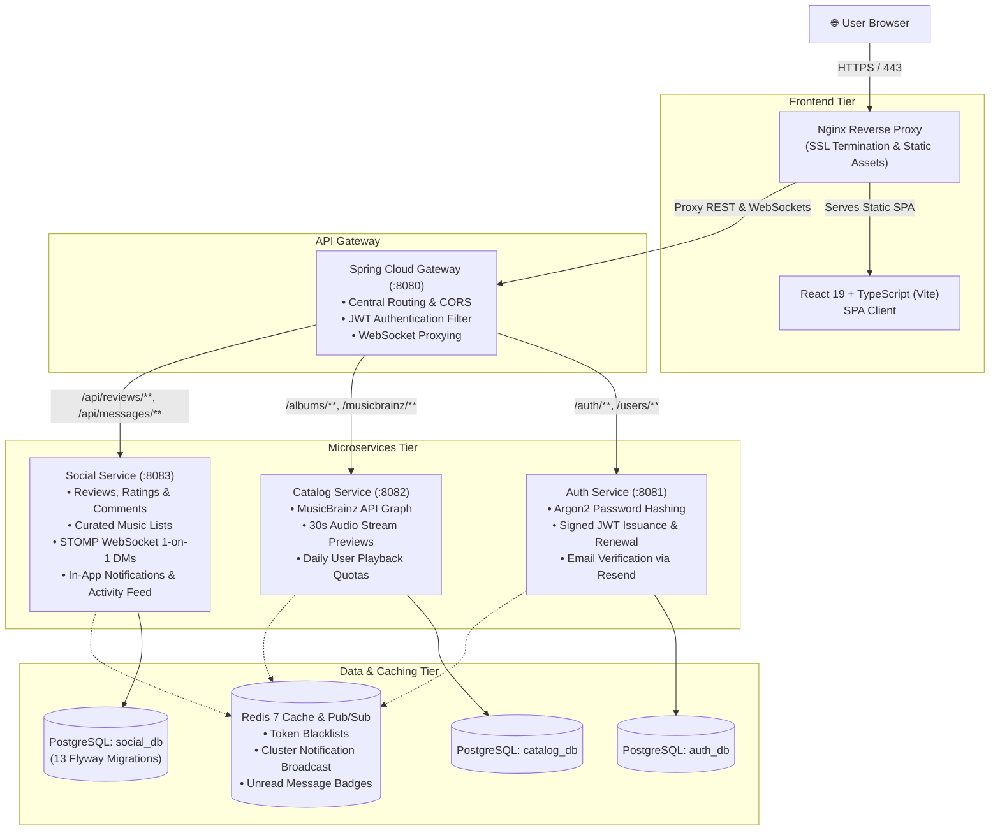

# Aficio — Music Social & Discovery Platform

<a href="https://aficio.shivesh29.me" target="_blank" rel="noopener noreferrer"></a>
[](https://openjdk.org/)
[](https://spring.io/projects/spring-boot)
[](https://react.dev/)
[](https://www.typescriptlang.org/)
[](https://www.postgresql.org/)
[](https://redis.io/)
[](https://www.docker.com/)
[](https://azure.microsoft.com/)

**Aficio** is a distributed, full-stack music discovery, review, and social networking platform. Built on a resilient **microservices architecture** with **Spring Boot 3**, **Spring Cloud Gateway**, and a modern **React + Vite** frontend, Aficio enables music enthusiasts to catalog albums, write rich reviews, stream track previews, curate custom lists, and engage in real-time direct messaging.

Live Production URL: <a href="https://aficio.shivesh29.me" target="_blank" rel="noopener noreferrer"><strong>https://aficio.shivesh29.me</strong></a>

---

## 🏛️ System Architecture



---

## ✨ Key Features

* **Music Graph & Catalog Exploration:** Integrated with the **MusicBrainz** API for release metadata, album tracklists, artist discographies, and high-resolution cover art.
* **30-Second Track Previews:** Integrated audio streaming with server-side playback quota management and active playbar controls.
* **Ratings & Rich Reviews:** 5-star scoring system with text critiques, community likes, and nested comment discussions.
* **Curated Music Lists:** Custom tracklists and album collections with privacy toggles (Public vs. Private).
* **Real-Time Direct Messaging:** Low-latency 1-on-1 messaging powered by **STOMP over SockJS/WebSockets**, featuring:
  * Real-time read receipts (`Check` / `CheckCheck` status indicators).
  * Dynamic unread conversation badges.
  * UTC-to-local timezone normalization.
* **Live Notifications & Activity Feed:** Instant push alerts for incoming messages and community interactions, backed by Redis Pub/Sub.
* **Account Customization & Security:**
  * Password hashing using Argon2/BCrypt.
  * Instant handle/username renaming with automatic, stateless JWT re-signing.
  * Account activation link verification.

---

## 🛠️ Tech Stack & Engineering Highlights

| Layer | Technologies |
|:---|:---|
| **Frontend** | React 19, TypeScript, Vite, React Router 7, Lucide Icons, Vanilla CSS Design System |
| **Backend** | Java 21, Spring Boot 3.4.1, Spring Cloud Gateway, Spring Data JPA, Spring Security |
| **Real-time Comms** | STOMP, SockJS, Spring WebSocket Messaging |
| **Databases & Cache** | PostgreSQL 16 (Multi-Database Pattern), Redis 7 (Alpine), Flyway DB Migrations |
| **Third-Party APIs** | MusicBrainz Web API, Resend Transactional Email API |
| **DevOps & Cloud** | Docker Compose, Azure Linux VM (Central India), Nginx, Let's Encrypt (Certbot), GitHub Actions |

---

## 💡 Engineering Highlights

### 1. Database Versioning with Flyway
Rather than relying on runtime JPA schema generation, all schema modifications follow strict database migration scripts (`V1__...` through `V13__add_read_status_to_direct_message.sql`). This ensures deterministic rollouts and foreign-key integrity across multiple schemas.

### 2. Network Isolation & Security Hardening
All backend databases (`PostgreSQL` on port 5432, `Redis` on port 6379) and microservices (`auth`, `catalog`, `social`) run inside a private Docker bridge network. Only the Nginx reverse proxy and the API Gateway expose controlled external ingress, preventing unauthorized access to the underlying storage layers.

### 3. Stateless Token Renewal
When a user updates their handle in account settings, the Auth service updates the database record, invalidates the previous user cache in Redis, and signs a new cryptographic JWT containing the updated identity claims without requiring re-authentication.

### 4. Cloud Cost Engineering
Deployed on Azure for Students with custom automated infrastructure schedules:
* Automated shutdown at midnight to eliminate compute charges when idle.
* Azure Logic App scheduler triggers automatic power-on daily at 9:00 AM IST.
* Docker containers configured with `restart: unless-stopped` to achieve automatic recovery on system boot within 90 seconds.

---

## 🚀 Running Locally

### Prerequisites
* [Docker Desktop](https://www.docker.com/products/docker-desktop/) (Docker Engine 24+ & Docker Compose v2+)
* [Node.js](https://nodejs.org/) v20+ *(Optional, for standalone frontend development)*
* [Java 21 JDK](https://adoptium.net/) & Maven *(Optional, for standalone service debugging)*

### Quickstart

1. **Clone the repository:**
   ```bash
   git clone https://github.com/Shivesh29/aficio.git
   cd aficio
   ```

2. **Configure environment variables:**
   ```bash
   cp .env.example .env
   ```
   *(The default `.env.example` comes with pre-filled local secrets and configurations for instant local running).*

3. **Start the application with Docker Compose:**
   ```bash
   docker compose up -d --build
   ```

4. **Access the application:**
   * **Frontend Web App:** [http://localhost:5174](http://localhost:5174)
   * **API Gateway:** [http://localhost:8080](http://localhost:8080)
   * **PostgreSQL:** `localhost:5432` (`auth_db`, `catalog_db`, `social_db`)
   * **Redis:** `localhost:6379`

To view container logs:
```bash
docker compose logs -f
```

To stop all containers:
```bash
docker compose down
```

---

## 📂 Repository Structure

```text
aficio/
├── .github/workflows/          # GitHub Actions CI automation (Java & React test/build)
├── frontend/                   # React 19 + TypeScript + Vite Single Page Application
│   ├── src/
│   │   ├── api/                # Typed REST client and models
│   │   ├── components/         # Shared UI components (Navbar, Modals, AudioPlayer)
│   │   ├── context/            # AuthContext, PlayerContext state providers
│   │   ├── pages/              # Catalog, AlbumDetail, Messages, Profile, Settings
│   │   └── utils/              # UTC-aware date utilities and formatters
├── services/
│   ├── api-gateway/            # Spring Cloud Gateway (Port 8080)
│   ├── auth-service/           # User authentication, JWT, Argon2, Resend email (Port 8081)
│   ├── catalog-service/        # MusicBrainz search, playback quotas, streaming (Port 8082)
│   └── social-service/         # Reviews, lists, DMs, STOMP WebSockets, notifications (Port 8083)
├── shared/
│   ├── dto-lib/                # Shared Java records and DTO contracts
│   └── kafka-events/           # Shared event schemas and publishers
├── docker-compose.yml          # Production & local multi-container orchestration
├── init-dbs.sh                 # Database initialization script for multi-schema PostgreSQL
└── deploy.ps1                  # Production deployment script for Azure cloud VM
```

---

## 📄 License

Copyright &copy; 2026 Shivesh Sharma. All rights reserved.
